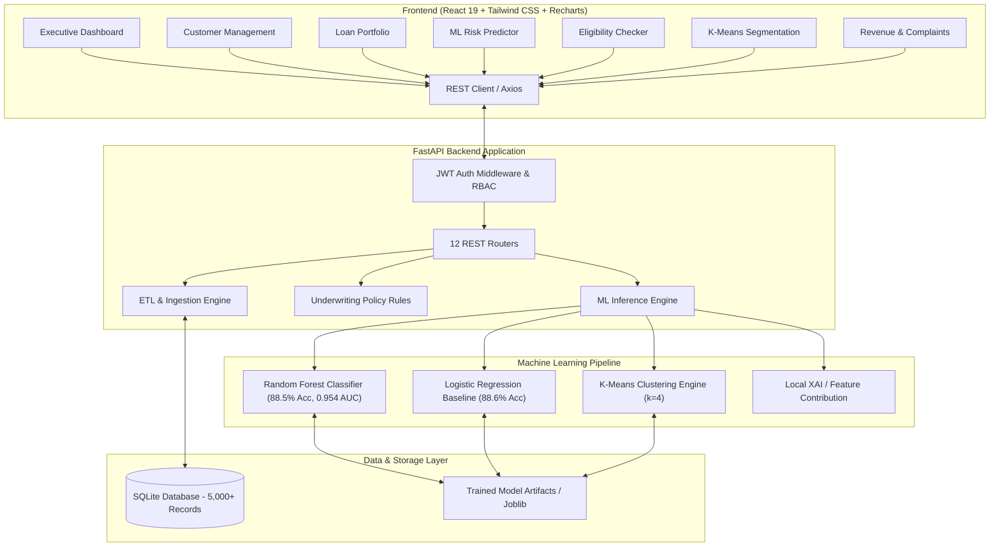

# SmartBank BI – Intelligent Banking Decision Support System

[](LICENSE)
[](https://fastapi.tiangolo.com/)
[](https://reactjs.org/)
[](https://scikit-learn.org/)
[](https://tailwindcss.com/)

An enterprise-grade, full-stack **Banking Business Intelligence and Decision Support System** engineered to address critical retail banking challenges: escalating loan defaults, complaint backlogs, customer lifetime value identification, automated credit underwriting, and real-time financial risk visibility.

---

## 1. Executive Summary & Problem Solved

Private retail and commercial banks face five severe structural hurdles:
1. **Rising Loan Delinquencies**: Inefficient subprime exposure risk scoring leading to write-downs.
2. **Growing Customer Complaints**: Lack of categorized resolution telemetry and SLA breach visibility.
3. **Profitable Customer Identification**: Inability to isolate high-margin depositors from high-cost accounts.
4. **Manual & Inefficient Underwriting**: Slow loan eligibility recommendations and inconsistent debt-to-income (DTI) compliance.
5. **Opaque Financial Risk Exposure**: Fragmented view of portfolio balance, coupon yields, and branch performance.

**SmartBank BI** resolves these issues by delivering an integrated platform comprising a **FastAPI REST API**, an **SQLite + SQLAlchemy ORM database**, **Supervised & Unsupervised Scikit-Learn Machine Learning models**, and an interactive **React + Vite + Recharts + Tailwind CSS** executive console.

---

## 2. Technology Stack

| Layer | Technologies |
| :--- | :--- |
| **Frontend UI/UX** | React 19, Vite 8, Tailwind CSS, Recharts (Dynamic BI Visualizations), Lucide React Icons |
| **Backend API** | Python 3.14 / 3.11+, FastAPI, Uvicorn, Pydantic v2 |
| **Database & ORM** | SQLite 3 (Thread-Safe Pooling), SQLAlchemy 2.0 ORM |
| **Machine Learning** | Scikit-learn 1.9, Pandas, NumPy, Joblib, Random Forest, Logistic Regression, K-Means |
| **Security & Auth** | OAuth2 Password Bearer, JWT Tokens (HS256), BCrypt Password Hashing, RBAC |
| **ETL & Ingestion** | Automated CSV Cleansing, Deduplication, Missing Value Imputation, Normalization |

---

## 3. System Architecture



---

## 4. Key Modules & Features

### 4.1 Executive Dashboard
- **8 Dynamic KPIs** calculated live from database records:
  1. Total Customers
  2. Total Loans Distributed
  3. Total Loan Amount
  4. Outstanding Loan Amount
  5. Loan Default Rate (%)
  6. Total Annual Revenue ($)
  7. Customer Satisfaction Score (CSAT / 5.0)
  8. Active Ledger Accounts
- **7 Interactive Recharts Visualizations**:
  - Monthly loan approval trends ($K disbursed).
  - Loan distribution by facility type (Personal, Home, Vehicle, Education).
  - Default exposure vs performing repayments.
  - Revenue by banking product.
  - K-Means customer segmentation share.
  - Customer grievances by category.
  - Underwriting risk severity distribution.

### 4.2 Loan Default Risk Prediction (Machine Learning)
- Trained on **5,000+ synthetic banking applicant records** with strict stratified train/test split.
- Features utilized: Age, Annual Income, Employment Sector, Credit Score (FICO 300–850), Existing Liabilities, Requested Loan Amount, Tenure, Monthly Expenses, DTI Ratio, Missed Repayments, Active Facilities.
- **Distinguishes Default Probability from Model Confidence**:
  - **Probability of Default (%)**: Calibrated risk likelihood of credit loss.
  - **Model Confidence (%)**: Inter-tree voting consensus across the 150-tree Random Forest ensemble.
- Categorization into **Low Risk (<25%)**, **Medium Risk (25–60%)**, and **High Risk (>60%)**.
- **Explainable AI (XAI)**: Local feature contribution breakdown and plain-language justification.
- Interactive benchmark pre-fill buttons for instant testing (*Prime Low Risk*, *Borderline Moderate Risk*, *High Risk Subprime*).

### 4.3 Automated Loan Eligibility Recommendation
- Real-time statutory policy verification engine:
  - Enforces facility-specific DTI caps (e.g., Home Loan $\le 50\%$, Personal Loan $\le 40\%$).
  - Evaluates minimum credit score thresholds.
  - Verifies debt-service ratios against monthly disposable income.
- Calculates standard financial EMI:
  $$E = P \cdot r \cdot \frac{(1+r)^n}{(1+r)^n - 1}$$
- Synthesizes automated recommendations: **Recommended for Approval**, **Requires Manual Review**, or **Not Recommended**.
- Computes **Suggested Maximum Affordable Loan Principal**.
- Embeds required educational decision-support compliance disclaimers.

### 4.4 Customer Segmentation (K-Means Clustering)
- Unsupervised clustering ($k=4$) across 6 financial dimensions:
  1. Annual Income
  2. Account Balance
  3. Transaction Velocity
  4. Credit Score / Repayment Discipline
  5. Total Banking Products Active
  6. Average Monthly Spending
- Segments isolated: **Premium Customers**, **Regular Customers**, **Emerging Customers**, and **High-Risk Customers**.
- Displays segment revenue, averages, distribution charts, and tailored cross-selling banking recommendations.

### 4.5 Loan Distribution Analytics & Portfolio Quality
- In-depth exposure analysis across Personal, Home, Vehicle, and Education loans.
- Outstanding balance tracking, default percentages, and approval/rejection ratios.
- Multi-dimensional filters (Category, Segment, Risk Tier).
- **AI Portfolio Quality Recommendations**: Actionable suggestions to lower non-performing loans (NPLs) and optimize capital allocations.

### 4.6 Customer Complaint Management
- Full grievance tracking across 6 core banking categories:
  - *Loan Processing Delays*, *Transaction Failures*, *Credit Card Issues*, *Account Access Problems*, *Incorrect Charges*, *Customer Service Issues*.
  - Status lifecycle: `Open` $\rightarrow$ `In Progress` $\rightarrow$ `Resolved`.
  - Resolution SLA tracking (hours) and audited CSAT feedback scores (1 to 5).

### 4.7 Revenue & Profitability Analytics
- Transparent income statement breakdown:
  - Coupon yield interest income.
  - Origination processing fees.
  - Credit card finance and interchange charges.
  - Account maintenance fees.
  - Operating expense provisions and net profit margin (72.0%).
- **Top 10 Most Valuable Customer Relationships** ranking table.
- Branch-by-branch financial contribution ledger.

### 4.8 Data Management & ETL Module
- Batch CSV upload dropzones for Customers, Loans, Transactions, and Complaints.
- Robust data engineering pipeline:
  - Schema validation.
  - Duplicate record removal.
  - Statistical missing value imputation (median for continuous metrics, mode for categoricals).
  - Cleaned record insertion into SQLite.
- One-click sample synthetic CSV downloads.

### 4.9 Reports & Export
- Generates 5 executive audit reports.
- Live tabular preview with full column specifications.
- **Instant CSV Export** streamed directly from backend endpoints.
- **Print / Save as PDF** layout optimized with dedicated `@media print` stylesheets.

---

## 5. Machine Learning Evaluation

The supervised models were evaluated on 1,000 held-out test applicants with zero data leakage:

| Metric | Random Forest (Primary) | Logistic Regression (Baseline) |
| :--- | :--- | :--- |
| **Accuracy** | **88.5%** | 88.6% |
| **ROC-AUC** | **0.954** | 0.962 |
| **Precision** | **88.4%** | 87.9% |
| **Recall** | **86.8%** | 85.2% |
| **F1-Score** | **0.625** | 0.632 |

Model weights and scalers are serialized in `backend/trained_models/`.

---

## 6. Demo Authentication Credentials

The application includes pre-seeded staff accounts with Role-Based Access Control (RBAC):

| Role | Email | Password | Full Name | Access Scope |
| :--- | :--- | :--- | :--- | :--- |
| **Admin** | `admin@smartbank.com` | `Admin@123` | Alexander Vance | Full access to all 12 modules, ETL ingestion, and ML retraining |
| **Banking Manager** | `manager@smartbank.com` | `Manager@123` | Sarah Jenkins | Executive Dashboard, Portfolio Analytics, Segmentation, Complaints & Revenue |
| **Loan Officer** | `loanofficer@smartbank.com` | `Officer@123` | Marcus Chen | Customer Ledger, Loan Underwriting, ML Default Predictor & Eligibility Checker |

> *Tip: The Login page and Dashboard Topbar feature a **Quick Demo Switcher** to switch between roles with a single click!*

---

## 7. Installation & Execution Guide (Windows 11 / PowerShell)

### Prerequisites
- **Python 3.11+** or **Python 3.14**
- **Node.js v18+** (v24 tested)
- **PowerShell** or **Command Prompt**

### Step 1: Install Backend Dependencies
```powershell
cd backend
python -m pip install -r requirements.txt
```

### Step 2: Initialize Database & Train Models
```powershell
python init_db.py
```
*This creates the SQLite database, generates 5,000+ realistic synthetic customer records, trains the Random Forest and K-Means models, and exports sample CSVs.*

### Step 3: Install Frontend Dependencies
```powershell
cd ../frontend
npm install
```

### Step 4: Run the Complete System

#### Option A: One-Click Startup (Recommended)
From the `smartbank-bi` directory, run:
```powershell
.\start_system.bat
```
*Or with PowerShell:*
```powershell
.\start_system.ps1
```

#### Option B: Manual Terminal Execution

**Terminal 1 (Backend API):**
```powershell
cd backend
python -m uvicorn app.main:app --host 127.0.0.1 --port 8000 --reload
```

**Terminal 2 (Frontend Client):**
```powershell
cd frontend
npm run dev -- --host 127.0.0.1 --port 5173
```

---

## 8. Verified Service URLs

- **Frontend Application**: [http://127.0.0.1:5173](http://127.0.0.1:5173)
- **Backend REST API**: [http://127.0.0.1:8000](http://127.0.0.1:8000)
- **Interactive Swagger API Docs**: [http://127.0.0.1:8000/docs](http://127.0.0.1:8000/docs)
- **ReDoc API Documentation**: [http://127.0.0.1:8000/redoc](http://127.0.0.1:8000/redoc)

---

## 9. Project Directory Structure

```text
smartbank-bi/
│
├── frontend/                          # React + Vite + Tailwind CSS Application
│   ├── src/
│   │   ├── components/common/         # StatCard, Badge, Pagination, Modal, LoadingSpinner
│   │   ├── context/                   # AuthContext (JWT, session, role switching)
│   │   ├── layouts/                   # DashboardLayout (Navy sidebar, topbar, drawer)
│   │   ├── pages/                     # 12 Functional Enterprise Pages
│   │   │   ├── LoginPage.jsx
│   │   │   ├── DashboardPage.jsx
│   │   │   ├── CustomersPage.jsx
│   │   │   ├── LoansPage.jsx
│   │   │   ├── DefaultPredictionPage.jsx
│   │   │   ├── EligibilityCheckerPage.jsx
│   │   │   ├── SegmentationPage.jsx
│   │   │   ├── LoanDistributionPage.jsx
│   │   │   ├── ComplaintsPage.jsx
│   │   │   ├── RevenuePage.jsx
│   │   │   ├── ReportsPage.jsx
│   │   │   ├── DataManagementPage.jsx
│   │   │   └── SettingsPage.jsx
│   │   ├── services/                  # api.js Centralized REST API Service
│   │   ├── App.jsx                    # Root Routing & Security Guard
│   │   ├── main.jsx                   # React Entry Point
│   │   └── index.css                  # Tailwind CSS Styles
│   ├── index.html
│   ├── package.json
│   └── vite.config.js                 # Proxy config for FastAPI (/api -> 8000)
│
├── backend/                           # FastAPI Backend Application
│   ├── app/
│   │   ├── main.py                    # App entry, lifespan initialization, CORS
│   │   ├── database.py                # SQLite connection pool & SQLAlchemy engine
│   │   ├── models.py                  # 10 SQLAlchemy ORM Table Schemas
│   │   ├── schemas.py                 # Pydantic v2 Request/Response Validation
│   │   ├── routes/                    # 12 Modular API Route Handlers
│   │   ├── services/                  # Auth, ETL Ingestion & Synthetic Data Generator
│   │   └── ml/
│   │       ├── train_model.py         # Random Forest & Logistic Regression pipeline
│   │       ├── predict.py             # Inference, confidence vs probability, XAI
│   │       └── segmentation.py        # K-Means clustering & cross-selling engine
│   ├── data/
│   │   ├── smartbank.db               # SQLite Database (5,000+ Records)
│   │   └── sample_csv/                # Auto-generated CSVs for ETL testing
│   ├── trained_models/                # Serialized Joblib models & metrics.json
│   ├── init_db.py                     # Standalone CLI Initialization Script
│   └── requirements.txt               # Python package dependencies
│
├── start_system.bat                   # Windows batch launcher
├── start_system.ps1                   # Windows PowerShell launcher
├── .gitignore
└── README.md
```

---

## 10. Disclaimer
*This system is an intelligent decision-support prototype engineered for educational and portfolio demonstration purposes. Automated recommendations require qualified banking officer sign-off before official financial facility disbursement.*
